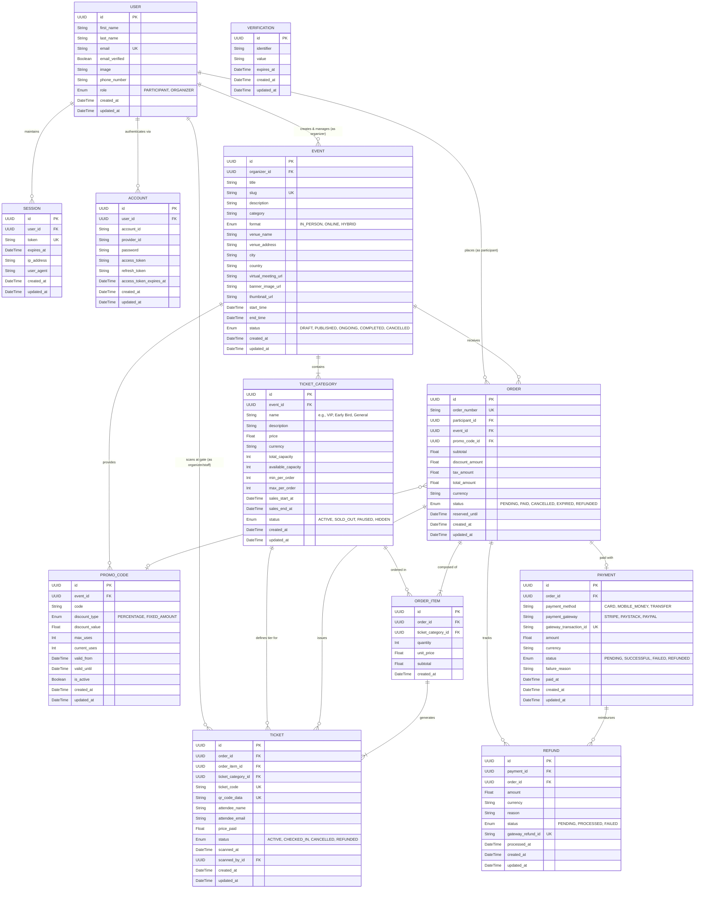

# Database Architecture & Schema Specification

## Entity Relationship (ER) Diagram

---

## Architectural Enhancements & Key Additions

### 1. Two-Role Model (`PARTICIPANT` vs `ORGANIZER`)
- **Participant:** Discovers events, reserves tickets, executes payments, receives individual QR tickets, and attends.
- **Organizer:** Creates events, specifies venue/stream details, creates ticket tiers/pricing, issues promo codes, and scans/validates attendee tickets at the gate.

### 2. Full Authentication Integration (Better Auth)
- Added **`Session`**, **`Account`**, and **`Verification`** tables.
- Separates user profiles from authentication provider state (credentials, Google/GitHub OAuth, session revocation, email verification, password reset tokens).

### 3. Order Items & Line-Item Pricing (`ORDER_ITEM`)
- **Why it was missing:** The initial draft linked `ORDER` directly to `TICKET`. In real ticketing, users purchase mixed bundles (e.g., 2 VIP + 1 Regular) in one order.
- **Solution:** `ORDER_ITEM` records the exact snapshot of `unit_price`, `quantity`, and `subtotal`, shielding transactions from future ticket price adjustments.

### 4. Concurrency & Overselling Prevention (`reserved_until`)
- Adds `reserved_until` to `ORDER` and `available_capacity` to `TICKET_CATEGORY`.
- When checkout starts, tickets are reserved for a 10–15 minute holding window. If payment times out, inventory releases automatically.

### 5. Check-In & Gate Verification Tracking
- **`Ticket`** includes `scanned_at` and `scanned_by_id` (`FK -> User`).
- Prevents double-scanning fraud and provides an audit trail of which organizer/staff member checked in the attendee.
- Includes `attendee_name` and `attendee_email` for multi-ticket buyer allocations.

### 6. Event Locations & Media Assets
- Added event formats: `IN_PERSON`, `ONLINE`, `HYBRID`.
- Full venue attributes (`venue_name`, `venue_address`, `city`, `country`) and secure `virtual_meeting_url`.
- Promotional assets: `banner_image_url`, `thumbnail_url`.

### 7. Dynamic Promotions (`PROMO_CODE`)
- Replaces static event-level discounts with flexible coupon campaigns (`PERCENTAGE` or `FIXED_AMOUNT`), maximum usage limits, and expiration windows.

### 8. Payment Gateway Audit & Refunds (`PAYMENT`, `REFUND`)
- Added `gateway_transaction_id`, `payment_gateway` (e.g., Stripe, Paystack), and currency tracking.
- Added **`REFUND`** model for handling event cancellations, date changes, and chargebacks.